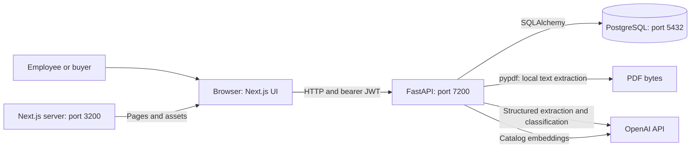
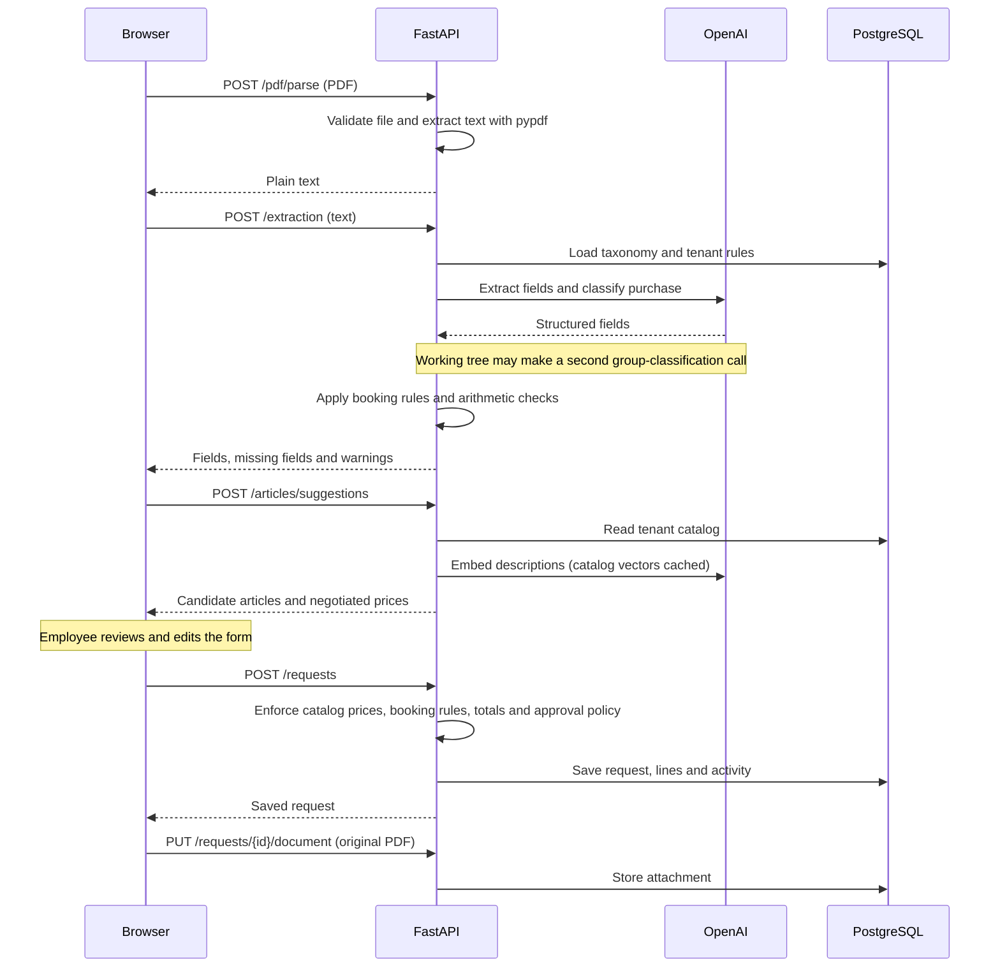
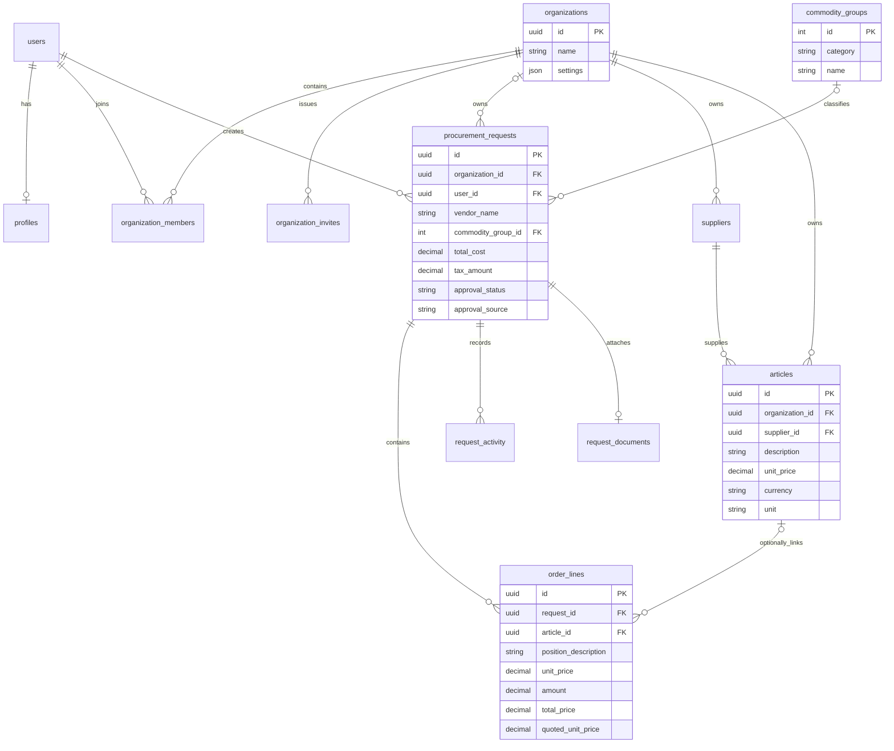

# Architecture

[Documentation index](README.md) · Reviewed 2026-11-04

The application has a Next.js frontend, one FastAPI backend and PostgreSQL. Files in `backend/app/services/` are modules inside that backend, not separately deployed services. OpenAI is an external dependency for interpreting quote text and matching catalog descriptions.

## Components and communication

The browser calls FastAPI directly using [the typed API client](../frontend/src/lib/api/client.ts). `NEXT_PUBLIC_API_URL` is included in the frontend at build time. The JWT is stored in local storage under `lio_token`.

[Authentication dependencies](../backend/app/core/deps.py) resolve the user and their membership. Tenant-owned requests, suppliers and articles are scoped by organisation. Commodity groups are shared reference data. Memberships support multiple rows in the database, but the current dependency selects a user's first membership; there is no active-organisation selector.

| Layer | Location | Responsibility |
| --- | --- | --- |
| Pages and forms | [frontend/src/app](../frontend/src/app) | Upload, review, catalog suggestions, request tracking and approval UI |
| API endpoints | [backend/app/routers](../backend/app/routers) | Authentication, tenant scope, validation and saving |
| Business logic | [backend/app/services](../backend/app/services) | Extraction, matching, booking rules, totals and approval policy |
| API shapes | [backend/app/schemas](../backend/app/schemas) | Pydantic validation and response contracts |
| Persistence | [backend/app/models](../backend/app/models) | SQLAlchemy tables and relationships |
| Schema and demo data | [migrations](../backend/alembic/versions), [seed](../backend/app/seed.py) | Apply schema changes, then insert missing reference/demo data |

## From quote to request

The parse and extraction calls are separate. Parsing does not store the original PDF; attachment happens after request creation and is a separate operation. A manual request can bypass extraction.

The merged baseline sends all groups in one extraction call. The uncommitted optimisation selects a category first, then a group from that category, unless a booking rule supplies the group. See [classification](commodity-classification.md) for its exact scope.

## Database relationships

This diagram shows the main foreign keys. Request ownership links are nullable in the schema for legacy compatibility; API-created requests use the current membership. Users also have nullable approval/audit links, omitted here for readability.

Important details:

- A category is a **text field on commodity groups**, not a separate table. The seed has 2,000 generated groups plus Office Supplies (2001).
- A request stores a free-text `vendor_name`; it has **no supplier foreign key**. Catalog linkage exists on individual order lines.
- Articles have a currency; requests have **no currency field**.
- Original PDFs are stored as bytes in `request_documents`, with at most one document per request.
- Tenant configuration lives in `organizations.settings`: `required_fields`, `booking_rules` and `auto_approval`. Settings updates merge supplied top-level fields; this is not a general recursive merge.

## Roles and business decisions

A requester creates and tracks requests. A buyer can approve or reject. An admin can also manage organisation settings and members. These are the implemented roles; there is no separate “manager” role.

The server applies catalog prices before calculating line totals, enforces the organisation's booking rule, calculates the gross total, then checks auto-approval. UI hints do not replace those checks.

Runtime versions, startup and accounts are in the [app README](../README.md). Database changes are in [migrations](migrations.md). Model accuracy and policy assumptions are documented in the individual feature pages.
